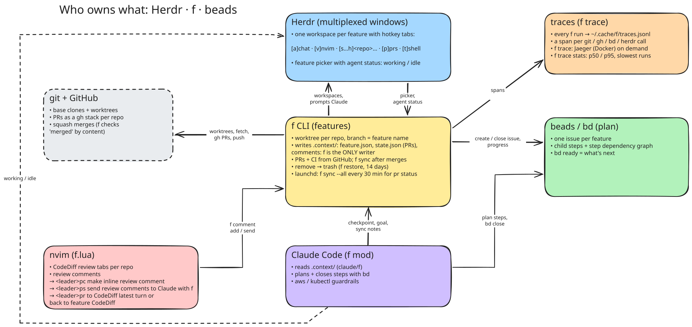

# f

My Claude Code config and the feature-workspace setup around it (Herdr + nvim + beads).
**Day-to-day use: [GUIDE.md](GUIDE.md).**



## Install

```bash
just install            # deploy f + Claude Code config + nvim module, launchd sync, git hooks
                        # (afterwards every commit/pull on main deploys by itself)
just herdr-integration  # Herdr agent-state hooks for Claude Code (busy/idle marks)
just                    # every recipe (checks, sync-now, trace, ...)
```

## Layout

- `claude/`: Claude Code (linked to `~/.claude/f`): the `f` mod (`claude/f/`), statusline, settings
- `cmd/f/`: `f`, the multi-repo feature workspace CLI (`f --help`)
- `mockups/`: HTML layout mockups
- `docs/separation-of-concerns.excalidraw` (+ `.svg` export): who owns what (Herdr, f, beads, the agent, nvim)

## f

`f` starts one agent session that works across several repos, each on its own git
worktree (`f -h` for commands).

- Per machine, `~/.config/f/config.json` says where features live (`home`,
  default `~/code/features`; `F_BASE` overrides) and which repos you can pick
  (`repos`: paths, or `dir/*` for every repo in dir; default `<home>/*`), plus
  optional `agent_rules` for every feature's AGENTS.md:
  `{"home": "~/code/features", "repos": ["~/code/work/*", "~/code/github/me/dotfiles"], "agent_rules": ["CI logs: `x logs <id>`"]}`.
- Features live in `<home>/.features/<name>/<repo>` (branch = name). Feature
  state is local-only in `<feature>/.context/` (`feature.json`, PRs, comments),
  written only by `f`.
- Inside Herdr each feature gets a workspace: `chat · nvim · <repo>… · prs · shell`,
  each repo tab a live CodeDiff (`<leader>pr` toggles whole feature ↔ the agent's last
  run, `<leader>pp` picks one PR of the stack); `prs` is `f prs --watch` (PRs + checks, polls GitHub only while checks
  run or just after a push). Outside Herdr, the agent starts in the current terminal.
- Done features are removed from the picker (`ctrl-x`; `f restore` for 14 days).
- Every `f` run is traced to `~/.cache/f/traces.jsonl` (OTLP/JSON, 7 days): `f trace`
  opens it in Jaeger, `f trace stats` summarizes it.
- Plumbing used by the agent (`claude/f/`) and nvim (`nvim/f.lua`):
  `f goal`, `f comment`, `f checkpoint`, `f prs --json/--add`.

## Guard

The agent never uses admin AWS profiles or production kube contexts
(`claude/f/`; logic in `internal/guard`):

- At start, `f creds` writes filtered copies of `~/.aws/config`,
  `~/.aws/credentials`, and the kubeconfig to `~/.cache/f/guard/` and points
  the agent's environment at them. Every command and script the agent runs (aws, kubectl,
  terraform, boto3, ...) only sees allowed profiles/contexts.
- Before each bash command, `f guard check` blocks naming a denied
  profile/context/EKS cluster, or pointing back at the real files.
- Rules: generic defaults (deny profiles `*admin*`, `*prod*`; contexts
  `*prod*`) plus machine-specific `~/.config/f/guard.json`, e.g.
  `{"allow_profiles": ["team-eks-admin"], "default_profile": "team-read-only"}`.

## Beads

One beads db for all features: `<home>/.beads` (local, metrics off).

- Every feature gets a beads issue (`f <name>`; older features on next reopen),
  id in `.context/feature.json`. The goal (first prompt) is its description.
- Multi-step work: the agent plans steps as child issues with dependencies and works
  them in `bd ready` order (instructions in the feature's AGENTS.md).
- The agent links each step to its PRs (`bd update <id> --external-ref "<url> <url>"`);
  `f sync` (and the 30-min `f sync --all`) closes a step once all its PRs have
  merged. Steps without PRs are closed by hand.
- The picker shows progress (`3/5 done · next: …`), synced after each agent turn.
- Cleanup closes the issue (with merged PR links). If plan steps are still
  open, it stays open with a note.
- History: `bd list --status closed`.

